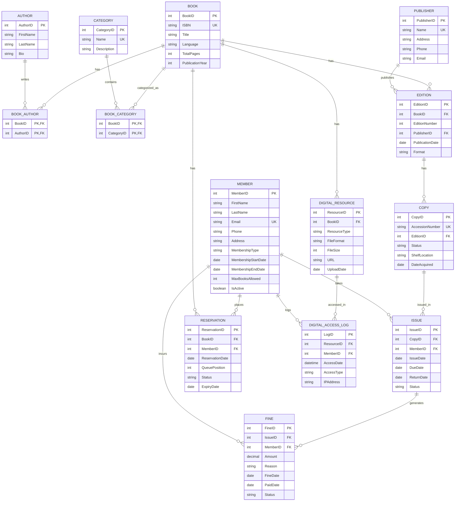

# ER Diagram Documentation: Library Circulation and Digital Resource Management System

This document provides a comprehensive Entity-Relationship (ER) model for the Library Circulation and Digital Resource Management System. It outlines all entities, attributes, constraints, relationships, and participation rules, accompanied by a Mermaid ER diagram.

---

## 1. Entity Listing with Attributes

Below is the detailed list of entities with their respective attributes, primary keys (PK), foreign keys (FK), and constraints.

### 1.1. Book
| Attribute | Type | Key | Constraints | Description |
| :--- | :--- | :--- | :--- | :--- |
| BookID | Integer | PK | | Unique identifier for a book. |
| ISBN | String | | UNIQUE, NOT NULL | International Standard Book Number. |
| Title | String | | NOT NULL | Title of the book. |
| Language | String | | | Language of the book. |
| TotalPages | Integer | | | Total number of pages. |
| PublicationYear | Integer | | | Year the book was originally published. |

### 1.2. Author
| Attribute | Type | Key | Constraints | Description |
| :--- | :--- | :--- | :--- | :--- |
| AuthorID | Integer | PK | | Unique identifier for an author. |
| FirstName | String | | NOT NULL | Author's first name. |
| LastName | String | | NOT NULL | Author's last name. |
| Bio | Text | | | Biographical information about the author. |

### 1.3. BookAuthor (Junction Table)
| Attribute | Type | Key | Constraints | Description |
| :--- | :--- | :--- | :--- | :--- |
| BookID | Integer | PK, FK | Ref: Book(BookID) | Part of composite PK. |
| AuthorID | Integer | PK, FK | Ref: Author(AuthorID)| Part of composite PK. |

### 1.4. Publisher
| Attribute | Type | Key | Constraints | Description |
| :--- | :--- | :--- | :--- | :--- |
| PublisherID | Integer | PK | | Unique identifier for a publisher. |
| Name | String | | NOT NULL, UNIQUE | Name of the publisher. |
| Address | String | | | Physical address. |
| Phone | String | | | Contact phone number. |
| Email | String | | | Contact email address. |

### 1.5. Category
| Attribute | Type | Key | Constraints | Description |
| :--- | :--- | :--- | :--- | :--- |
| CategoryID | Integer | PK | | Unique identifier for a category. |
| Name | String | | NOT NULL, UNIQUE | Name of the category (e.g., Sci-Fi). |
| Description | Text | | | Description of the category. |

### 1.6. BookCategory (Junction Table)
| Attribute | Type | Key | Constraints | Description |
| :--- | :--- | :--- | :--- | :--- |
| BookID | Integer | PK, FK | Ref: Book(BookID) | Part of composite PK. |
| CategoryID | Integer | PK, FK | Ref: Category(CategoryID)| Part of composite PK. |

### 1.7. Edition
| Attribute | Type | Key | Constraints | Description |
| :--- | :--- | :--- | :--- | :--- |
| EditionID | Integer | PK | | Unique identifier for a book edition. |
| BookID | Integer | FK | NOT NULL | Ref: Book(BookID) |
| EditionNumber | Integer | | NOT NULL | e.g., 1 for 1st Edition. |
| PublisherID | Integer | FK | | Ref: Publisher(PublisherID) |
| PublicationDate | Date | | | Date the edition was published. |
| Format | String | | | Print or Digital. |

### 1.8. Copy
| Attribute | Type | Key | Constraints | Description |
| :--- | :--- | :--- | :--- | :--- |
| CopyID | Integer | PK | | Unique identifier for a physical copy. |
| AccessionNumber| String | | UNIQUE, NOT NULL | Unique library inventory number. |
| EditionID | Integer | FK | NOT NULL | Ref: Edition(EditionID) |
| Status | String | | DEFAULT 'Available' | Available, Issued, Reserved, Lost, Damaged |
| ShelfLocation | String | | | Physical location in the library. |
| DateAcquired | Date | | | Date the copy was acquired. |

### 1.9. Member
| Attribute | Type | Key | Constraints | Description |
| :--- | :--- | :--- | :--- | :--- |
| MemberID | Integer | PK | | Unique identifier for a member. |
| FirstName | String | | NOT NULL | Member's first name. |
| LastName | String | | NOT NULL | Member's last name. |
| Email | String | | UNIQUE, NOT NULL | Member's email address. |
| Phone | String | | | Member's phone number. |
| Address | String | | | Member's residential address. |
| MembershipType | String | | NOT NULL | Student, Faculty, External |
| MembershipStartDate | Date | | NOT NULL | Start date of membership. |
| MembershipEndDate | Date | | | End date of membership. |
| MaxBooksAllowed| Integer | | DEFAULT based on type| Maximum books they can borrow. |
| IsActive | Boolean | | DEFAULT TRUE | Membership status. |

### 1.10. Issue
| Attribute | Type | Key | Constraints | Description |
| :--- | :--- | :--- | :--- | :--- |
| IssueID | Integer | PK | | Unique identifier for an issue record. |
| CopyID | Integer | FK | NOT NULL | Ref: Copy(CopyID) |
| MemberID | Integer | FK | NOT NULL | Ref: Member(MemberID) |
| IssueDate | Date | | NOT NULL, DEFAULT CURRENT_DATE | Date the book was issued. |
| DueDate | Date | | NOT NULL | Date the book is due. |
| ReturnDate | Date | | Nullable | Actual return date. |
| Status | String | | DEFAULT 'Active' | Active, Returned, Overdue |

### 1.11. Reservation
| Attribute | Type | Key | Constraints | Description |
| :--- | :--- | :--- | :--- | :--- |
| ReservationID | Integer | PK | | Unique identifier for a reservation. |
| BookID | Integer | FK | NOT NULL | Ref: Book(BookID) |
| MemberID | Integer | FK | NOT NULL | Ref: Member(MemberID) |
| ReservationDate| Date | | NOT NULL, DEFAULT CURRENT_DATE | Date the reservation was placed. |
| QueuePosition | Integer | | NOT NULL | Position in the waiting queue. |
| Status | String | | DEFAULT 'Waiting' | Waiting, Notified, Fulfilled, Cancelled |
| ExpiryDate | Date | | | Date the reservation expires. |

### 1.12. Fine
| Attribute | Type | Key | Constraints | Description |
| :--- | :--- | :--- | :--- | :--- |
| FineID | Integer | PK | | Unique identifier for a fine. |
| IssueID | Integer | FK | NOT NULL | Ref: Issue(IssueID) |
| MemberID | Integer | FK | NOT NULL | Ref: Member(MemberID) |
| Amount | Decimal | | NOT NULL, CHECK >= 0 | Fine amount in currency. |
| Reason | String | | | Overdue, Damage, Lost |
| FineDate | Date | | NOT NULL | Date the fine was levied. |
| PaidDate | Date | | Nullable | Date the fine was paid. |
| Status | String | | DEFAULT 'Pending' | Pending, Paid |

### 1.13. DigitalResource
| Attribute | Type | Key | Constraints | Description |
| :--- | :--- | :--- | :--- | :--- |
| ResourceID | Integer | PK | | Unique identifier for a digital resource. |
| BookID | Integer | FK | NOT NULL | Ref: Book(BookID) |
| ResourceType | String | | NOT NULL | E-Book, Journal, Audiobook |
| FileFormat | String | | | e.g., PDF, EPUB, MP3 |
| FileSize | Integer | | | Size of the file (e.g., in MB). |
| URL | String | | NOT NULL | Link to access/download the resource. |
| UploadDate | Date | | | Date the resource was added. |

### 1.14. DigitalAccessLog
| Attribute | Type | Key | Constraints | Description |
| :--- | :--- | :--- | :--- | :--- |
| LogID | Integer | PK | | Unique identifier for a log entry. |
| ResourceID | Integer | FK | NOT NULL | Ref: DigitalResource(ResourceID) |
| MemberID | Integer | FK | NOT NULL | Ref: Member(MemberID) |
| AccessDate | Datetime | | NOT NULL, DEFAULT CURRENT_TIMESTAMP | Timestamp of access. |
| AccessType | String | | | View, Download |
| IPAddress | String | | | IP address of the accessing user. |

---

## 2. Relationships

The following table summarizes all relationships between entities, including cardinality and descriptions.

| Entity 1 | Relationship | Entity 2 | Cardinality | Description |
| :--- | :--- | :--- | :--- | :--- |
| Book | —has→ | Author | M:N (via BookAuthor) | A book can have multiple authors; an author can write multiple books. |
| Book | —belongs to→ | Category | M:N (via BookCategory) | A book can belong to multiple categories; a category contains multiple books. |
| Book | —has→ | Edition | 1:N | A single book can have multiple editions over time. |
| Edition | —published by→| Publisher | N:1 | Multiple editions can be published by the same publisher. |
| Edition | —has→ | Copy | 1:N | An edition can have multiple physical copies in the library. |
| Copy | —issued in→ | Issue | 1:N | A copy can be issued multiple times, but only 1 issue is active at a time. |
| Member | —takes→ | Issue | 1:N | A member can borrow multiple copies over time. |
| Member | —places→ | Reservation | 1:N | A member can place multiple book reservations. |
| Book | —has→ | Reservation | 1:N | A book can have multiple reservations by different members. |
| Issue | —generates→ | Fine | 1:N | A single issue record can generate multiple fine entries (e.g., overdue then damaged). |
| Member | —incurs→ | Fine | 1:N | A member can incur multiple fines. |
| Book | —has→ | DigitalResource| 1:N | A book can have multiple associated digital resources (e.g., an E-book and an Audiobook). |
| DigitalResource | —accessed in→ | DigitalAccessLog| 1:N | A digital resource can be accessed multiple times. |
| Member | —logs→ | DigitalAccessLog| 1:N | A member can have multiple access logs for various resources. |

---

## 3. ER Diagram

Below is the COMPLETE Mermaid ER Diagram representing the schema.

---

## 4. Participation Constraints

Participation constraints dictate whether an entity's involvement in a relationship is mandatory (Total) or optional (Partial).

- **Total Participation (Mandatory):**
  - **Copy in Edition:** Every physical `Copy` MUST belong to a specific `Edition`. A copy cannot exist independently.
  - **Issue in Copy and Member:** Every `Issue` MUST be linked to exactly one `Copy` and exactly one `Member`.
  - **Fine in Issue and Member:** A `Fine` MUST be tied to a specific `Issue` and a specific `Member`.
  - **Edition in Book:** Every `Edition` MUST belong to a specific `Book`.
  - **DigitalResource in Book:** A `DigitalResource` MUST be linked to a `Book`.
  - **Reservation in Book and Member:** Every `Reservation` MUST be linked to a specific `Book` and a `Member`.
  - **DigitalAccessLog in DigitalResource and Member:** An access log MUST relate to both the resource accessed and the member who accessed it.
  - **Junction Tables:** Any record in `BookAuthor` MUST map to both a valid `Book` and a valid `Author`. The same applies to `BookCategory`.

- **Partial Participation (Optional):**
  - **Member in Issue:** A `Member` MAY or MAY NOT have active or historical `Issues`. They can just be registered without borrowing.
  - **Member in Fine:** A `Member` MAY incur a `Fine`, but it is not mandatory. Most members will not have fines.
  - **Book in DigitalResource:** A `Book` MAY NOT have any associated `DigitalResource` (e.g., if it is print-only).
  - **Copy in Issue:** A `Copy` MAY NOT be issued yet (it could just be sitting on the shelf).
  - **Publisher in Edition:** An `Edition` MAY theoretically lack a publisher in some systems (e.g., self-published without a formal publisher entity), though typically it is N:1. Here, `PublisherID` in `Edition` is a FK that could structurally be optional depending on strictness.
  - **Member in Reservation:** A `Member` MAY or MAY NOT place reservations.
