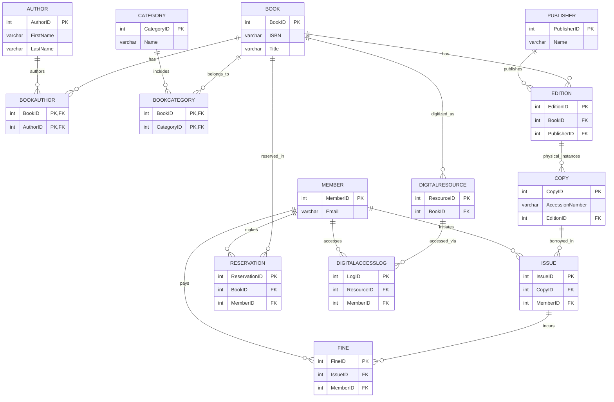

# Initial Relational Schema
## Library Circulation and Digital Resource Management System

This document outlines the detailed relational schema for the Library Circulation and Digital Resource Management System, including standard notation, detailed table definitions, key summaries, relationship diagrams, and integrity constraints.

## 1. Relational Schema Notation

The following defines the relational schema using standard notation.
* **Bold** text indicates a **PrimaryKey**.
* _Italic_ text indicates a _ForeignKey_.
* ***Bold Italic*** text indicates a field that is both part of the primary key and a foreign key.

1. **Book**(***BookID***, ISBN, Title, Language, TotalPages, PublicationYear)
2. **Author**(***AuthorID***, FirstName, LastName, Bio)
3. **BookAuthor**(***_BookID_***, ***_AuthorID_***)
4. **Publisher**(***PublisherID***, Name, Address, Phone, Email)
5. **Category**(***CategoryID***, Name, Description)
6. **BookCategory**(***_BookID_***, ***_CategoryID_***)
7. **Edition**(***EditionID***, _BookID_, EditionNumber, _PublisherID_, PublicationDate, Format)
8. **Copy**(***CopyID***, AccessionNumber, _EditionID_, Status, ShelfLocation, DateAcquired)
9. **Member**(***MemberID***, FirstName, LastName, Email, Phone, Address, MembershipType, MembershipStartDate, MembershipEndDate, MaxBooksAllowed, IsActive)
10. **Issue**(***IssueID***, _CopyID_, _MemberID_, IssueDate, DueDate, ReturnDate, Status)
11. **Reservation**(***ReservationID***, _BookID_, _MemberID_, ReservationDate, QueuePosition, Status, ExpiryDate)
12. **Fine**(***FineID***, _IssueID_, _MemberID_, Amount, Reason, FineDate, PaidDate, Status)
13. **DigitalResource**(***ResourceID***, _BookID_, ResourceType, FileFormat, FileSize, URL, UploadDate)
14. **DigitalAccessLog**(***LogID***, _ResourceID_, _MemberID_, AccessDate, AccessType, IPAddress)

## 2. Detailed Table Definitions

### 1. Book Table
| Column Name | Data Type | Constraints | Description |
| :--- | :--- | :--- | :--- |
| BookID | INT | PRIMARY KEY, AUTO_INCREMENT | Unique identifier for each book title |
| ISBN | VARCHAR(20) | UNIQUE, NOT NULL | International Standard Book Number |
| Title | VARCHAR(255) | NOT NULL | Title of the book |
| Language | VARCHAR(50) | NOT NULL | Language of the book |
| TotalPages | INT | CHECK (TotalPages > 0) | Total number of pages |
| PublicationYear | INT | NOT NULL | Year the book was originally published |

### 2. Author Table
| Column Name | Data Type | Constraints | Description |
| :--- | :--- | :--- | :--- |
| AuthorID | INT | PRIMARY KEY, AUTO_INCREMENT | Unique identifier for the author |
| FirstName | VARCHAR(100) | NOT NULL | Author's first name |
| LastName | VARCHAR(100) | NOT NULL | Author's last name |
| Bio | TEXT | | Brief biography of the author |

### 3. BookAuthor Table (Junction Table)
| Column Name | Data Type | Constraints | Description |
| :--- | :--- | :--- | :--- |
| BookID | INT | PRIMARY KEY, FOREIGN KEY | References Book(BookID) |
| AuthorID | INT | PRIMARY KEY, FOREIGN KEY | References Author(AuthorID) |

### 4. Publisher Table
| Column Name | Data Type | Constraints | Description |
| :--- | :--- | :--- | :--- |
| PublisherID | INT | PRIMARY KEY, AUTO_INCREMENT | Unique identifier for the publisher |
| Name | VARCHAR(150) | UNIQUE, NOT NULL | Name of the publisher |
| Address | VARCHAR(255) | | Physical address |
| Phone | VARCHAR(20) | | Contact phone number |
| Email | VARCHAR(100) | | Contact email address |

### 5. Category Table
| Column Name | Data Type | Constraints | Description |
| :--- | :--- | :--- | :--- |
| CategoryID | INT | PRIMARY KEY, AUTO_INCREMENT | Unique identifier for the category |
| Name | VARCHAR(100) | UNIQUE, NOT NULL | Name of the category (e.g., Fiction, Science) |
| Description | TEXT | | Description of the category |

### 6. BookCategory Table (Junction Table)
| Column Name | Data Type | Constraints | Description |
| :--- | :--- | :--- | :--- |
| BookID | INT | PRIMARY KEY, FOREIGN KEY | References Book(BookID) |
| CategoryID | INT | PRIMARY KEY, FOREIGN KEY | References Category(CategoryID) |

### 7. Edition Table
| Column Name | Data Type | Constraints | Description |
| :--- | :--- | :--- | :--- |
| EditionID | INT | PRIMARY KEY, AUTO_INCREMENT | Unique identifier for the specific edition |
| BookID | INT | FOREIGN KEY, NOT NULL | References Book(BookID) |
| EditionNumber | INT | NOT NULL, CHECK (EditionNumber > 0) | The edition number (1st, 2nd, etc.) |
| PublisherID | INT | FOREIGN KEY, NOT NULL | References Publisher(PublisherID) |
| PublicationDate | DATE | NOT NULL | Date this edition was published |
| Format | ENUM | NOT NULL | Format of the edition ('Hardcover', 'Paperback', etc.) |

### 8. Copy Table
| Column Name | Data Type | Constraints | Description |
| :--- | :--- | :--- | :--- |
| CopyID | INT | PRIMARY KEY, AUTO_INCREMENT | Unique identifier for the physical copy |
| AccessionNumber | VARCHAR(50) | UNIQUE, NOT NULL | Library's unique barcode or inventory number |
| EditionID | INT | FOREIGN KEY, NOT NULL | References Edition(EditionID) |
| Status | ENUM | NOT NULL, DEFAULT 'Available' | ('Available', 'Issued', 'Lost', 'Damaged', 'Reserved') |
| ShelfLocation | VARCHAR(100) | | Physical location in the library |
| DateAcquired | DATE | NOT NULL | Date the copy was added to inventory |

### 9. Member Table
| Column Name | Data Type | Constraints | Description |
| :--- | :--- | :--- | :--- |
| MemberID | INT | PRIMARY KEY, AUTO_INCREMENT | Unique identifier for the member |
| FirstName | VARCHAR(100) | NOT NULL | Member's first name |
| LastName | VARCHAR(100) | NOT NULL | Member's last name |
| Email | VARCHAR(150) | UNIQUE, NOT NULL | Member's email address |
| Phone | VARCHAR(20) | NOT NULL | Contact phone number |
| Address | VARCHAR(255) | | Residential address |
| MembershipType | ENUM | NOT NULL | Type of membership ('Student', 'Faculty', 'Staff', 'Public') |
| MembershipStartDate| DATE | NOT NULL | Start date of membership |
| MembershipEndDate | DATE | | Expiry date of membership |
| MaxBooksAllowed | INT | NOT NULL, CHECK (MaxBooksAllowed > 0) | Max simultaneous issues allowed |
| IsActive | BOOLEAN | NOT NULL, DEFAULT TRUE | Whether the member account is active |

### 10. Issue Table
| Column Name | Data Type | Constraints | Description |
| :--- | :--- | :--- | :--- |
| IssueID | INT | PRIMARY KEY, AUTO_INCREMENT | Unique transaction identifier |
| CopyID | INT | FOREIGN KEY, NOT NULL | References Copy(CopyID) |
| MemberID | INT | FOREIGN KEY, NOT NULL | References Member(MemberID) |
| IssueDate | DATE | NOT NULL | Date the copy was issued |
| DueDate | DATE | NOT NULL | Expected date of return |
| ReturnDate | DATE | | Actual date of return |
| Status | ENUM | NOT NULL, DEFAULT 'Active' | ('Active', 'Returned', 'Overdue') |

### 11. Reservation Table
| Column Name | Data Type | Constraints | Description |
| :--- | :--- | :--- | :--- |
| ReservationID | INT | PRIMARY KEY, AUTO_INCREMENT | Unique identifier for the reservation |
| BookID | INT | FOREIGN KEY, NOT NULL | References Book(BookID) |
| MemberID | INT | FOREIGN KEY, NOT NULL | References Member(MemberID) |
| ReservationDate | DATETIME | NOT NULL | Timestamp of reservation |
| QueuePosition | INT | NOT NULL, CHECK (QueuePosition >= 1) | Position in the waitlist |
| Status | ENUM | NOT NULL, DEFAULT 'Pending' | ('Pending', 'Fulfilled', 'Cancelled', 'Expired') |
| ExpiryDate | DATETIME | | When the reservation expires if not fulfilled |

### 12. Fine Table
| Column Name | Data Type | Constraints | Description |
| :--- | :--- | :--- | :--- |
| FineID | INT | PRIMARY KEY, AUTO_INCREMENT | Unique identifier for the fine |
| IssueID | INT | FOREIGN KEY, NOT NULL | References Issue(IssueID) |
| MemberID | INT | FOREIGN KEY, NOT NULL | References Member(MemberID) |
| Amount | DECIMAL(10,2) | NOT NULL, CHECK (Amount >= 0) | Monetary value of the fine |
| Reason | VARCHAR(255) | NOT NULL | E.g., 'Late Return', 'Damaged Book' |
| FineDate | DATE | NOT NULL | Date fine was assessed |
| PaidDate | DATE | | Date fine was paid |
| Status | ENUM | NOT NULL, DEFAULT 'Pending' | ('Pending', 'Paid', 'Waived') |

### 13. DigitalResource Table
| Column Name | Data Type | Constraints | Description |
| :--- | :--- | :--- | :--- |
| ResourceID | INT | PRIMARY KEY, AUTO_INCREMENT | Unique identifier for the digital file |
| BookID | INT | FOREIGN KEY, NOT NULL | References Book(BookID) |
| ResourceType | ENUM | NOT NULL | Type of resource ('EBook', 'Audiobook', 'Supplement') |
| FileFormat | VARCHAR(20) | NOT NULL | E.g., 'PDF', 'EPUB', 'MP3' |
| FileSize | INT | | File size in bytes/KB/MB |
| URL | VARCHAR(500) | NOT NULL | Link to access/download the file |
| UploadDate | DATETIME | NOT NULL | When the resource was added |

### 14. DigitalAccessLog Table
| Column Name | Data Type | Constraints | Description |
| :--- | :--- | :--- | :--- |
| LogID | INT | PRIMARY KEY, AUTO_INCREMENT | Unique log entry identifier |
| ResourceID | INT | FOREIGN KEY, NOT NULL | References DigitalResource(ResourceID) |
| MemberID | INT | FOREIGN KEY, NOT NULL | References Member(MemberID) |
| AccessDate | DATETIME | NOT NULL | Timestamp of access |
| AccessType | ENUM | NOT NULL | Type of access performed ('View', 'Download') |
| IPAddress | VARCHAR(45) | | IP address of the user |

## 3. Primary Keys and Foreign Keys Summary

| Table | Primary Key | Foreign Keys | Referenced Table |
| :--- | :--- | :--- | :--- |
| **Book** | BookID | None | - |
| **Author** | AuthorID | None | - |
| **BookAuthor** | BookID, AuthorID | BookID <br> AuthorID | Book(BookID) <br> Author(AuthorID) |
| **Publisher** | PublisherID | None | - |
| **Category** | CategoryID | None | - |
| **BookCategory** | BookID, CategoryID | BookID <br> CategoryID | Book(BookID) <br> Category(CategoryID) |
| **Edition** | EditionID | BookID <br> PublisherID | Book(BookID) <br> Publisher(PublisherID) |
| **Copy** | CopyID | EditionID | Edition(EditionID) |
| **Member** | MemberID | None | - |
| **Issue** | IssueID | CopyID <br> MemberID | Copy(CopyID) <br> Member(MemberID) |
| **Reservation** | ReservationID | BookID <br> MemberID | Book(BookID) <br> Member(MemberID) |
| **Fine** | FineID | IssueID <br> MemberID | Issue(IssueID) <br> Member(MemberID) |
| **DigitalResource** | ResourceID | BookID | Book(BookID) |
| **DigitalAccessLog** | LogID | ResourceID <br> MemberID | DigitalResource(ResourceID) <br> Member(MemberID) |

## 4. Relationship Diagram in Mermaid



## 5. Integrity Constraints Summary

### Entity Integrity (Primary Keys)
- `BookID` in **Book**
- `AuthorID` in **Author**
- `(BookID, AuthorID)` in **BookAuthor**
- `PublisherID` in **Publisher**
- `CategoryID` in **Category**
- `(BookID, CategoryID)` in **BookCategory**
- `EditionID` in **Edition**
- `CopyID` in **Copy**
- `MemberID` in **Member**
- `IssueID` in **Issue**
- `ReservationID` in **Reservation**
- `FineID` in **Fine**
- `ResourceID` in **DigitalResource**
- `LogID` in **DigitalAccessLog**

### Referential Integrity (Foreign Keys)
- **BookAuthor.BookID -> Book.BookID**: ON DELETE CASCADE (Deleting a book removes its authorship links)
- **BookAuthor.AuthorID -> Author.AuthorID**: ON DELETE CASCADE (Deleting an author removes authorship links)
- **BookCategory.BookID -> Book.BookID**: ON DELETE CASCADE (Deleting a book removes category links)
- **BookCategory.CategoryID -> Category.CategoryID**: ON DELETE CASCADE (Deleting a category removes links)
- **Edition.BookID -> Book.BookID**: ON DELETE CASCADE (Deleting a book removes its editions)
- **Edition.PublisherID -> Publisher.PublisherID**: ON DELETE RESTRICT (Cannot delete a publisher if they have editions in the system)
- **Copy.EditionID -> Edition.EditionID**: ON DELETE CASCADE (Deleting an edition removes physical copies)
- **Issue.CopyID -> Copy.CopyID**: ON DELETE RESTRICT (Cannot delete a physical copy if there is an active/historical issue record)
- **Issue.MemberID -> Member.MemberID**: ON DELETE RESTRICT (Cannot delete a member if they have issue history)
- **Reservation.BookID -> Book.BookID**: ON DELETE CASCADE (Deleting a book removes reservations for it)
- **Reservation.MemberID -> Member.MemberID**: ON DELETE CASCADE (Deleting a member removes their reservations)
- **Fine.IssueID -> Issue.IssueID**: ON DELETE CASCADE (Deleting an issue removes associated fines)
- **Fine.MemberID -> Member.MemberID**: ON DELETE CASCADE (Deleting a member removes their fines)
- **DigitalResource.BookID -> Book.BookID**: ON DELETE CASCADE (Deleting a book removes its digital resources)
- **DigitalAccessLog.ResourceID -> DigitalResource.ResourceID**: ON DELETE CASCADE (Deleting a digital resource removes its access logs)
- **DigitalAccessLog.MemberID -> Member.MemberID**: ON DELETE CASCADE (Deleting a member removes their access logs)

### Domain Constraints
- **UNIQUE**: `Book.ISBN`, `Copy.AccessionNumber`, `Member.Email`, `Publisher.Name`, `Category.Name`
- **NOT NULL**: All critical fields (e.g., `Title`, `FirstName`, `IssueDate`, `DueDate`)
- **CHECK**: 
  - `Fine.Amount >= 0`
  - `Book.TotalPages > 0`
  - `Edition.EditionNumber > 0`
  - `Member.MaxBooksAllowed > 0`
  - `Reservation.QueuePosition >= 1`
  - Valid ENUM values in Status fields and Types
- **DEFAULT**: 
  - `Copy.Status = 'Available'`
  - `Issue.Status = 'Active'`
  - `Reservation.Status = 'Pending'`
  - `Fine.Status = 'Pending'`
  - `Member.IsActive = TRUE`

### Business Rule Constraints
- Only one active issue per physical copy is permitted at any given time (enforced via application logic or triggers preventing `INSERT` if `Copy.Status != 'Available'`).
- `Issue.DueDate >= Issue.IssueDate`
- `Issue.ReturnDate >= Issue.IssueDate` (when `ReturnDate` is not null)
- `Reservation.QueuePosition >= 1` (Must logically increment for concurrent reservations on the same `BookID`)
- `Member.MaxBooksAllowed > 0` (Active issue count cannot exceed this limit for the member)

## 6. Schema Diagram (Text-based)

```text
Book ──1:N──> Edition ──1:N──> Copy ──1:N──> Issue ──1:N──> Fine
 │                                              │              │
 │                                              └──N:1── Member ──1:N──> Reservation
 │                                                        │
 ├──M:N──> Author (via BookAuthor)                        │
 ├──M:N──> Category (via BookCategory)                    │
 ├──1:N──> Reservation                                    │
 └──1:N──> DigitalResource ──1:N──> DigitalAccessLog ←──N:1──┘
```
